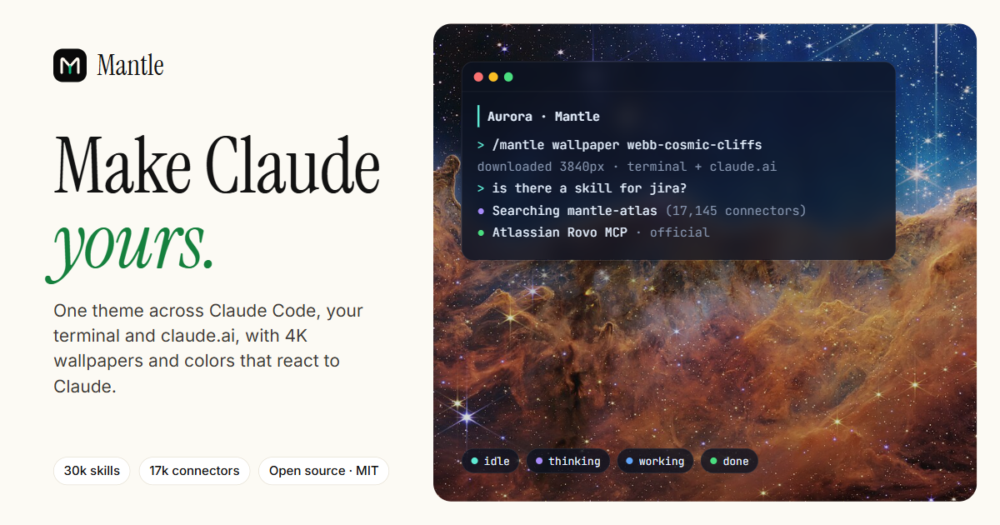
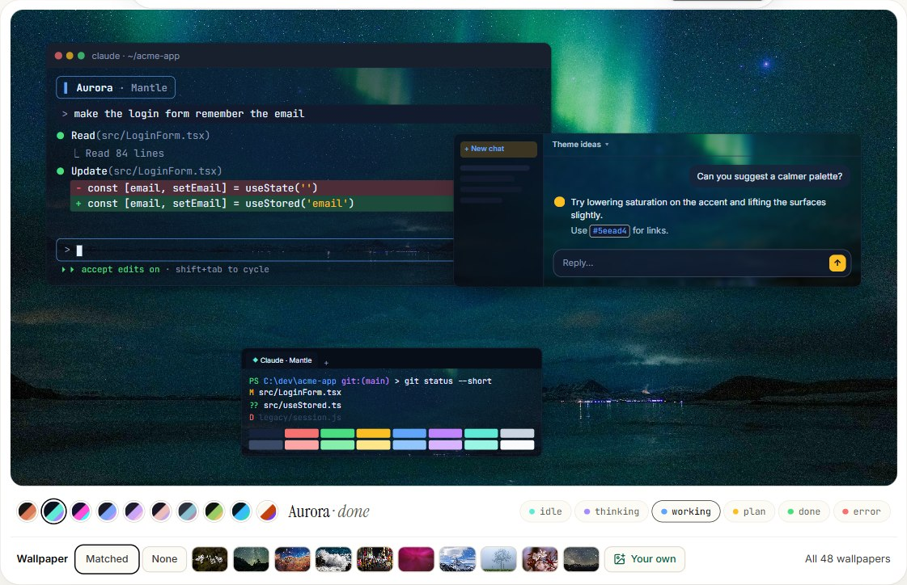
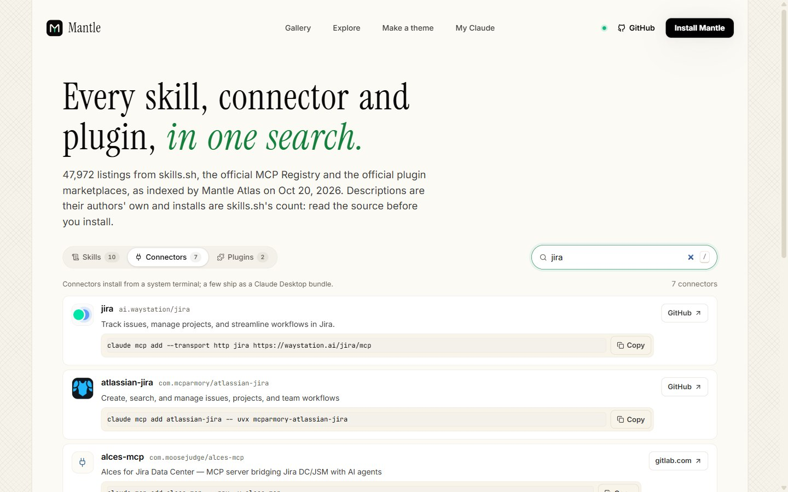

<div align="center">

<a href="https://github.com/AkshitTiwarii/mantle"></a>

<h1>Mantle</h1>

<p><b>Make Claude yours, and find the right tool for every job.</b><br>
Themes, 4K wallpapers and live colors for Claude Code, your terminal and claude.ai,<br>
a knowledge base of 47,000+ skills, connectors and plugins, and a check-up for your setup.</p>

<p>
<a href="https://github.com/AkshitTiwarii/mantle/releases/latest"></a>
<a href="LICENSE"></a>
<a href="https://github.com/AkshitTiwarii/mantle/stargazers"></a>

<a href="https://www.skills.sh/akshittiwarii/mantle/mantle-atlas"></a>

</p>

<p>
<a href="https://mantle.akshittiwari.me"><b>Website</b></a> ·
<a href="#install"><b>Install</b></a> ·
<a href="#mantle-atlas-the-knowledge-base"><b>Atlas</b></a> ·
<a href="#mantle-doctor-a-check-up-for-your-setup"><b>Doctor</b></a> ·
<a href="#one-theme-on-every-surface"><b>Themes</b></a> ·
<a href="CHANGELOG.md"><b>Changelog</b></a>
</p>

</div>

```text
/plugin install mantle --marketplace AkshitTiwarii/mantle
```

<p align="center"></p>
<p align="center"><sub>A real Claude Code session in its Mantle tab: the wallpaper behind it, and Atlas picking the official Jira connector with its install command.</sub></p>

## Why Mantle

Developers keep hitting the same walls with AI coding agents. Mantle fixes the ones a plugin can:

| The problem | What Mantle does |
| --- | --- |
| "There are thousands of skills and MCP servers; which one do I actually want?" | **Atlas** knows 30k skills, 17k connectors and 440 plugins, recommends 1–3 with when-to-use and the exact install command, and reads your project to suggest what fits **your** stack. |
| "Is this third-party skill safe to install?" | **Atlas vet** scans a skill's files for network pipes, credential reads, prompt-injection text and obfuscation before you install it. |
| "My context fills up before I've typed anything." | **Doctor** shows what loads into every session (skill descriptions, CLAUDE.md, MCP servers) and what to trim. |
| "Claude ignores my CLAUDE.md." | **Doctor** flags long files, duplicate and vague rules, stale paths, and rules a hook should enforce instead. |
| "My MCP server won't start on Windows." / "I pasted my API key into .mcp.json." | **Doctor** catches `npx` without `cmd /c`, and secrets written into MCP config (without printing them). |
| "Permission prompts all day." | **Doctor** proposes a read-only starter allowlist from your project's own scripts, and flags rules that are too broad. |
| "Every terminal looks the same." | One theme across Claude Code, Windows Terminal / iTerm2 and claude.ai, with 4K wallpapers and colors that react to what Claude is doing. |

Mantle is an independent, MIT-licensed project. It is not affiliated with Anthropic.

---

## What you get

| | What it does |
| --- | --- |
| **Mantle plugin** (`mantle/`) | A Claude Code plugin that themes Claude Code, your terminal and claude.ai together, puts a wallpaper behind Claude, and recolors it live as Claude thinks, runs tools, plans, finishes or errors. Adds `/mantle doctor`. |
| **Mantle Atlas** (`mantle/skills/mantle-atlas/`) | A skill that turns Claude (or Cursor, Codex, Copilot, Gemini CLI…) into an expert on every skill, connector, plugin and Claude Code feature, with stack recommendations and a trust check. |
| **Mantle Doctor** (`mantle/skills/mantle-doctor/`) | A read-only check-up of your setup: context cost, CLAUDE.md hygiene, MCP problems, leaked secrets, permissions. Claude applies the fixes you approve. |
| **Mantle web** (`web/`) | Search the whole index, a gallery with live previews and one-click install commands, a theme maker, and "My Claude", a local dashboard of what you have installed. |

---

## Install

### In Claude Code

At the Claude Code prompt:

```
/plugin install mantle --marketplace AkshitTiwarii/mantle
```

From a shell:

```bash
claude plugin install mantle --marketplace AkshitTiwarii/mantle
```

In the Claude desktop app's Code tab: click **+** next to the prompt box → **Plugins** → **Add marketplace** `AkshitTiwarii/mantle` → **Add plugin**.

Then run `/mantle` to open the studio, or `/mantle aurora` to apply a theme everywhere.

### In any other agent (Atlas and Doctor)

```bash
npx skills add AkshitTiwarii/mantle --skill mantle-atlas
npx skills add AkshitTiwarii/mantle --skill mantle-doctor
```

Target a specific agent with `-a cursor`, `-a codex`, `-a github-copilot`, `-a gemini-cli`, `-a windsurf`, `-a cline`, or `-a '*'` for all of them.

### Let your agent do it

Paste this into Claude Code:

> Install Mantle for me: run `claude plugin install mantle --marketplace AkshitTiwarii/mantle` in the terminal. When it finishes, tell me to run /reload-plugins and then /mantle aurora.

Or into Cursor, Codex, Copilot, Gemini CLI, Windsurf or Cline (swap the `-a` value):

> Install the Mantle Atlas skill: run `npx skills add AkshitTiwarii/mantle --skill mantle-atlas -a cursor -y`. From now on, whenever I ask which skill, connector, plugin or setting fits a task, use mantle-atlas to answer.

The website's hero has the same prompts, one tab per agent, with a copy button.

---

## Everything Mantle does

### One theme on every surface

<p align="center"></p>

One apply recolors three places at once:

- **Claude Code:** every interface color — accent, prompt border, diffs, your message background, plan and accept-edits modes, status colors — through a native theme file (`~/.claude/themes/mantle.json`, selected as **Mantle (live)** in `/theme`).
- **Your terminal:** Claude runs in its own **Claude · Mantle** tab with the wallpaper and matching colors (all 16 ANSI colors, opacity, blur); your other tabs stay plain.
  - **Windows Terminal:** run `/mantle shortcut on` once. After that, typing `claude` in any PowerShell tab opens Claude in a new Claude · Mantle tab in the same folder (set `$env:MANTLE_INLINE = 1` to run it in place; `/mantle shortcut off` removes the shortcut from your PowerShell profile). Mantle's look is a settings fragment, so your `settings.json` is never edited, and changes show live. Windows Terminal ties a wallpaper to a profile, not a tab, which is why Claude gets a profile of its own. `/mantle terminal everywhere on` puts the look on your own profile instead.
  - **macOS (iTerm2):** written as an iTerm2 Dynamic Profile, **Claude · Mantle**, which iTerm2 picks up live; `/mantle open` starts Claude in it. Terminal.app can't load a wallpaper from a file, so it gets Claude Code's colors only.
- **claude.ai** (Chrome): page colors, a blurred wallpaper behind frosted panels, readable buttons, and a light that sweeps across the top while Claude replies. Done by a bundled Chrome extension that recolors claude.ai's own design tokens.

Each surface can also be customized separately in the studio: its own preset, accent, wallpaper, opacity or blur.


### Colors that react to Claude

While you work, the Claude Code theme shifts with Claude's state:

| Claude is… | Accent and prompt border turn |
| --- | --- |
| idle | the theme's accent |
| thinking | its second accent |
| running a tool | the info color |
| in plan mode | the warning color |
| done with an answer | success, for 2.5 s |
| hitting an error or refusal | error, for 5 s |

On claude.ai a light sweeps across the page and the accent shifts while a reply streams. Turn reactions off with `/mantle live off`.

### Wallpapers

- `/mantle wallpaper <https URL | image file | off>` downloads an image and puts it behind your terminal and claude.ai in one step.
- The website has **48 freely licensed 4K wallpapers** (flowers, nature, mountains, NASA/Webb space, ocean, city, minimal, abstract), each credited to its photographer with its license. Every theme preview on the site shows one behind it.
- **Your own image** works everywhere: attach it on the website (it never leaves your browser tab), point `/mantle wallpaper` at the file, or pick it in the extension popup.

### The studio pane

`/mantle` opens a pane beside the chat with:

- a main preset and a live swatch strip;
- on/off switches for each surface (Claude Code, Windows Terminal, claude.ai) and for live reactions;
- a **Claude Code** tab: idle accent, thinking color, tool-running color, your message background;
- a **Terminal** tab: wallpaper path, wallpaper strength, window opacity, acrylic, font, background override;
- a **claude.ai** tab: wallpaper, blur, dim, panel opacity, accent, the reply glow, and reinstalling the extension files;
- **Apply everywhere**, with a short log of what changed.

### Ten presets

Ember, Aurora, Synthwave, Tokyo Night, Catppuccin Mocha, Rosé Pine, Nord Night, Forest, Deep Ocean and Paper (light). They also appear on their own in Claude Code's `/theme` picker.

### Mantle Atlas, the knowledge base

Ask Claude things like:

- "Is there a skill for filling PDF forms?"
- "Connect Claude to Jira."
- "How do I make Claude run my tests after every edit?"
- "What's the best way to share our team's prompts?"
- "How can I change how Claude Code looks?"

Atlas answers with 1–3 options, best first: what each does, when to use it, when to skip it, the exact install command, and how to use it afterwards. It also flags anything that needs API keys or broad access.

What it knows:

| Area | Curated guide (with judgment) | Full searchable index |
| --- | --- | --- |
| Skills | ~170 skills grouped by job, including animation, motion and video | 30,483 skills from skills.sh, with install counts; top 5,000 described |
| Connectors (MCP) | 156 connectors grouped by job, Composio included | 17,145 servers from the official MCP Registry, each with a setup command |
| Plugins | ~90 plugins, 13 marketplaces | 439 plugins from Anthropic's marketplaces and Mantle |
| Claude Code features | 37 features: what, when, how | — |
| Choosing a mechanism | 28 goals mapped to the right tool (skill vs hook vs MCP vs plugin vs CLAUDE.md…) | — |
| UI customization | themes, status lines, terminals, claude.ai, wallpapers, and what can't be themed | — |

Ask **"what should I install for this project?"** and Atlas reads your project (package.json, pyproject, go.mod, Dockerfile, CI, deploy config) and picks from its curated guides for the stack it finds, skipping what you already have. Ask **"is this skill safe?"** and it vets the skill's files first.

Tools that ship with it:

```bash
node mantle/skills/mantle-atlas/scripts/search.mjs "jira" --type connectors
node mantle/skills/mantle-atlas/scripts/search.mjs "pdf forms" --live   # also asks skills.sh and the MCP Registry now
node mantle/skills/mantle-atlas/scripts/recommend.mjs .                 # picks for this project's stack
node mantle/skills/mantle-atlas/scripts/vet.mjs owner/repo --skill name # trust check before installing
node mantle/skills/mantle-atlas/scripts/refresh.mjs                     # rebuild the index from live sources (~10 min)
```

`recommend.mjs` on this repo's website detects React, Tailwind, shadcn/ui, Motion and TypeScript and suggests the React and design skills, the TypeScript language server and Context7 for current docs. `vet.mjs` flags network pipes into a shell, credential reads, sending env vars to remote hosts, writes to shell profiles or Claude settings, permission bypasses, prompt-injection text, invisible Unicode and obfuscation, each with file:line. It is a heuristic, not a guarantee.

Claude always knows Atlas exists; the guides and index load only when a question needs them, so your context isn't flooded. Atlas never edits your memory on its own. If you ask it to "always remember," it shows you a three-line note for `~/.claude/CLAUDE.md` and adds it only on your yes.

Sources: skills.sh, each skill's SKILL.md on GitHub, the official MCP Registry, Anthropic's plugin marketplaces and the Claude Code docs.

### Mantle Doctor, a check-up for your setup

Run `/mantle doctor` in Claude Code, or ask Claude to "check my setup". It reads your config (never writes, never prints secret values) and reports:

| Check | What it catches |
| --- | --- |
| Context cost | How many tokens load into every session from skill descriptions and CLAUDE.md files, and which skills are heaviest. Flags more than six MCP servers and points you at `/context`. |
| CLAUDE.md | Files over 200 lines, duplicate rules, vague rules ("write clean code"), paths that no longer exist, missing `@imports`, and "never/always" rules a hook should enforce instead. |
| MCP | `npx` servers on Windows without the `cmd /c` wrapper (they fail to start), and API keys written into `.mcp.json` or `~/.claude.json`. |
| Skills | Duplicates installed in two places, missing descriptions, descriptions over the 1024-character limit. |
| Permissions | `bypassPermissions`, allow rules as broad as `Bash(*)`, a readable `.env`, plus a read-only starter allowlist built from your project's own scripts. |

```text
## FIX · MCP server "github" runs npx directly on Windows
-> Native Windows can't spawn npx without a shell. Re-add it as: claude mcp add github -- cmd /c npx -y @modelcontextprotocol/server-github
## FIX · MCP server "github" has a secret written into its config
-> .mcp.json is usually committed: move the value to an environment variable and reference it as ${VAR}, then rotate the key if it was pushed.
## REVIEW · Broad allow rule: Bash(*)
```

Claude then offers each fix, applies only the ones you approve, and runs the check again. Works in any agent that reads skills: `npx skills add AkshitTiwarii/mantle --skill mantle-doctor`.

### The website

Live at **[mantle.akshittiwari.me](https://mantle.akshittiwari.me)**. To run it yourself (My Claude needs this, since it reads your local setup):

```bash
cd web
npm install
npm run dev
```

Open http://127.0.0.1:5173.

<p align="center"></p>

- **Explore:** search all 47,972 skills, connectors and plugins in the index, rank by name and installs, copy the install command, and share a search as a link (`/explore?q=jira&t=connectors`). Press `/` to search.
- **Gallery:** themes, wallpapers, skills, connectors and plugins in one place, each with its maker's logo. Theme cards preview live on hover, cycling through Claude's states over their wallpaper. Every listing links to its source and copies its install command in one click.
- **Set up with your agent:** prompts for Claude Code, Cursor, Codex, GitHub Copilot, Gemini CLI, Windsurf, Cline or any agent.
- **Make a theme:** start from a preset, or build a theme straight from a wallpaper or your own photo (the colors are read in your browser; nothing is uploaded). Lock the colors you like and shuffle the rest with Space, undo with Ctrl+Z, check contrast on every color, and share the result as a link. Claude Code, claude.ai and the terminal update live over the wallpaper; export a Claude Code theme, a Windows Terminal scheme and a claude.ai payload.
- **My Claude:** a local companion (127.0.0.1 only) lists the skills, plugins, connectors, themes and marketplaces you already have, with secrets masked. Its only write is applying a Mantle theme after you confirm.

---

## Commands

| Command | What it does |
| --- | --- |
| `/mantle` | Opens the studio pane |
| `/mantle apply` | Applies the current settings to every surface that's switched on |
| `/mantle doctor` | Runs the setup check-up for the current project |
| `/mantle <preset>` | Switches preset and applies it, e.g. `/mantle synthwave` |
| `/mantle wallpaper <url \| file \| off>` | Downloads an image and puts it behind your terminal and claude.ai |
| `/mantle shortcut on \| off` | Windows: makes `claude` in PowerShell open in its own Claude · Mantle tab (adds or removes a marked block in your PowerShell profile) |
| `/mantle open` | Starts Claude in a new Claude · Mantle tab (Windows Terminal) or window (iTerm2) in this folder |
| `/mantle live on \| off` | Turns live reactions on or off |
| `/mantle terminal everywhere on \| off` | Also themes the Windows Terminal profile you run `/mantle` from (off by default) |

## Where it works

| Surface | Colors | Wallpaper | Live reactions |
| --- | --- | --- | --- |
| Claude Code (terminal) | Yes | Yes, via your terminal | Yes |
| Windows Terminal | Yes | Yes | Colors set on apply |
| iTerm2 (macOS) | Yes | Yes | Colors set on apply |
| Terminal.app (macOS) | Claude Code's colors | No | Yes |
| claude.ai in Chrome | Yes | Yes | Yes (reply glow) |
| VS Code (terminal and Claude extension) | Follows your VS Code theme | No | No |
| Claude desktop app | No | No | No |

The Claude desktop app's interface can't be themed: its bundle is integrity-checked. Mantle's plugin and Atlas still run in its Code tab.

## Load the claude.ai extension

1. Run `/mantle apply` once; it writes the extension to `~/.claude/mantle/chrome-extension`.
2. In Chrome open `chrome://extensions`, turn on **Developer mode**, click **Load unpacked**, and pick that folder.

After that every apply reaches open claude.ai tabs within seconds. The popup works on its own too: presets, accent, wallpaper upload or URL, blur, dim, panel opacity, the reply glow.

## Privacy and safety

- Everything runs on your machine. The plugin makes no network calls except downloading a wallpaper you asked for.
- The website's local companion binds to 127.0.0.1, reads `~/.claude` read-only, masks secrets, and writes only `themes/mantle.json` after you confirm.
- Atlas recommends; it never installs or configures anything unless you ask.
- Third-party skills and MCP servers run with your permissions. Atlas tells you which ones need keys or broad access; review their source before installing.

## Repository layout

```
mantle/                    Claude Code plugin
  hooks/register.tsx       the mod: /mantle, studio pane, live reactions, wallpaper
  chrome-extension/        claude.ai extension (content script, popup, palettes)
  themes/                  10 presets as standalone Claude Code themes
  skills/mantle-atlas/     the knowledge-base skill
    SKILL.md
    references/            curated guides
    data/                  full index (skills, connectors, plugins)
    scripts/               search, recommend, vet, refresh
  skills/mantle-doctor/    the setup check-up skill (scripts/doctor.mjs)
  tests/                   plugin tests
web/                       the website (Vite, React, Tailwind, motion)
  server/                  local companion for My Claude
  scripts/build-index.mjs  turns the Atlas index into the Explore page's search data
docs/images/               README screenshots
PRODUCT.md, DESIGN.md      product and design records
```

## Develop

```bash
claude --plugin-dir ./mantle      # run the plugin from this folder
claude plugin validate ./mantle   # check the manifest and hooks
claude plugin test ./mantle       # run the plugin tests
cd web && npm run build           # type-check and build the site
```

## Credits

- Presets Tokyo Night, Catppuccin Mocha, Rosé Pine and Nord Night adapt the colors of [Tokyo Night](https://github.com/folke/tokyonight.nvim), [Catppuccin](https://catppuccin.com), [Rosé Pine](https://rosepinetheme.com) and [Nord](https://www.nordtheme.com).
- Wallpapers come from Wikimedia Commons and NASA, each credited on its card with its license (public domain, CC0, CC BY, CC BY-SA).
- Agent logos from [Simple Icons](https://simpleicons.org) (CC0); trademarks belong to their owners.
- UI components from [Aceternity UI](https://ui.aceternity.com); design process with [Impeccable](https://impeccable.style).
- Skill and connector data from [skills.sh](https://www.skills.sh) and the [official MCP Registry](https://registry.modelcontextprotocol.io).

## From the creator of ZeroCarbon

Mantle is made by [Akshit Tiwari](https://github.com/AkshitTiwarii), who also builds [ZeroCarbon](https://zerocarbon.org.in).

## License

MIT, see [LICENSE](LICENSE).
